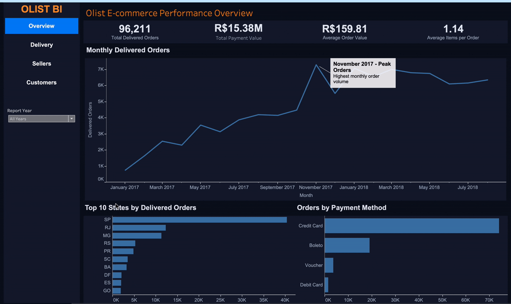
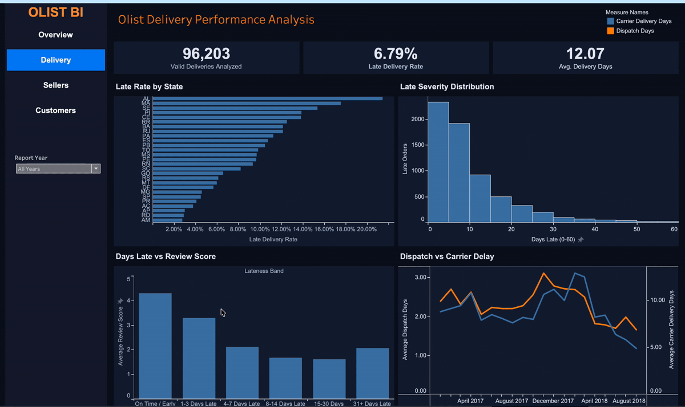
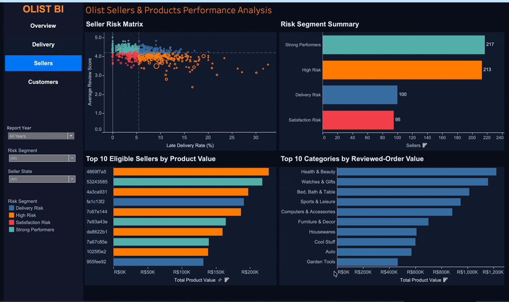
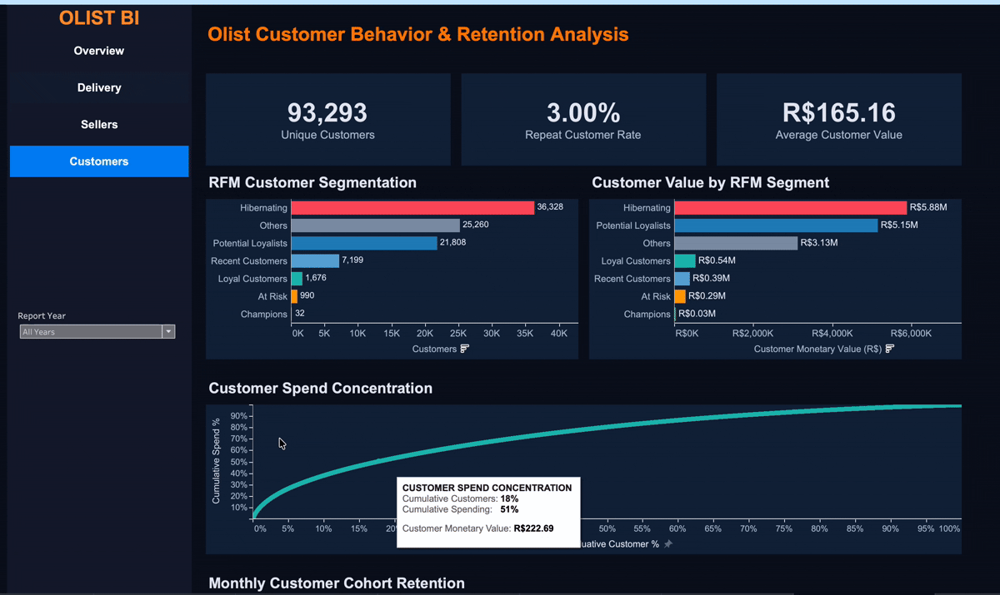

# 🛒 Olist E-Commerce Analytics

**Python · MySQL 8+ · Tableau Public | End-to-end marketplace analytics**

An interactive analysis of Brazilian Olist marketplace orders, delivery operations, sellers, product categories, and customer retention. The project combines data preparation, reusable SQL views, validated metrics, and four Tableau dashboards.

**[▶ View the interactive Tableau dashboards](https://public.tableau.com/views/OlistE-CommerceAnalyticsOrdersDeliverySellersCustomers/OlistE-commercePerformanceOverview)** · **[📁 GitHub repository](https://github.com/Parthuaddala/olist-ecommerce-analytics)**

**Period:** January 2017–August 2018 (2018 partial) · **Currency:** Brazilian real (R$) · **Scope:** Primarily delivered orders

---

## 📊 Performance at a glance

| Measure | Result |
|---|---:|
| Delivered orders | **96,211** |
| Total payment value | **R$15.38M** |
| Average order value | **R$159.81** |
| Valid delivery records | **96,203** |
| Late delivery rate | **6.79%** |
| Customers in latest cumulative snapshot | **93,293** |
| Repeat customer rate | **3.00%** |

The delivery analysis excludes eight orders without customer delivery dates. Customer metrics use cumulative snapshots and are not restricted to the same population as the Overview dashboard.

---

## 🖥️ Interactive dashboards

The previews demonstrate the filters. Open the [published Tableau workbook](https://public.tableau.com/views/OlistE-CommerceAnalyticsOrdersDeliverySellersCustomers/OlistE-commercePerformanceOverview) to explore the tooltips and charts yourself.

### 📈 1. Marketplace overview



**What it shows:** Delivered orders, payment value, average order value, monthly trends, customer-state performance, and payment methods. The **Report Year** control switches between All Years, 2017, and 2018.

### 🚚 2. Delivery performance



**What it shows:** Late-delivery rates by state, delay severity, review-score relationships, and fulfillment timing. Dispatch measures **approval → carrier handoff**; transit measures **carrier handoff → customer delivery**.

### 🏪 3. Sellers & products



**What it shows:** Seller risk segments, top sellers by product value, and top categories by reviewed-order product value. Filters include Report Year, Risk Segment, and Seller State. Seller risk eligibility requires **at least 30 delivered orders per period**.

### 👥 4. Customer behavior & retention



**What it shows:** Unique customers, repeat rate, average customer value, RFM segments, spend concentration, and monthly cohort retention. RFM metrics use historical snapshots, not independent calendar-year customer totals.

---

## 💡 Key findings

| Insight | Evidence | Possible action |
|---|---|---|
| **Repeat buying is uncommon** | **3.00%** repeat customer rate in the latest snapshot | Test second-purchase campaigns |
| **Spending is concentrated** | Top **10%** of customers generated **38.25%** of monetary value (2017: **38.68%**) | Monitor high-value customer retention |
| **Delivery performance differs by state** | Overall late rate **6.79%**, with substantial geographic variation | Prioritize high-rate, high-volume markets |
| **Delays correlate with worse reviews** | Early/on-time reviewed orders averaged **4.29** stars; 4–7 days late averaged **2.11** | Investigate fulfillment and communication issues |
| **Cohort return rates are low** | Observed later-month retention generally below **1%** | Track cohort-based repeat behavior |

These are descriptive findings. The suggested actions should be evaluated with experiments or further analysis rather than interpreted as proven causal effects.

---

## 🛠️ Tools and workflow

| Tool | Work completed |
|---|---|
| **Python / pandas / Jupyter** | Source inspection, cleaning, prepared import files |
| **MySQL 8+** | Database setup, validation, reusable analytical views, business SQL, RFM and cohort analysis |
| **Tableau Public** | Four linked dashboards, parameter filters, KPI cards, ranking visuals, cohort heatmap, and tooltips |
| **Git & GitHub** | Project organization, reproducible SQL, export datasets, workbook, and animated previews |

```text
Olist source CSVs
       ↓
Python inspection and preparation
       ↓
MySQL setup and validation
       ↓
Analytical views and business SQL
       ↓
Nine Tableau-ready datasets
       ↓
Four interactive dashboards
       ↓
Tableau Public
```

**SQL concepts:** Joins across different grains · CTEs · recursive CTEs · conditional aggregation · window functions (`ROW_NUMBER`, `NTILE`, `LAG`) · ranking · cumulative calculations · RFM · cohort retention.

---

## 📂 Repository contents

```text
olist-ecommerce-analytics/
├── README.md
├── .gitignore
├── notebooks/
│   ├── 01_data_inspection.ipynb
│   └── 01_data_preparation.ipynb
├── sql/
│   ├── 01_database_setup.sql
│   ├── 02_data_validation.sql
│   ├── 03_analysis_views.sql
│   ├── 04_business_analysis.sql
│   ├── 05_advanced_sql_analysis.sql
│   └── 06_tableau_datasets.sql
├── data/
│   ├── raw/                 # local only, excluded from GitHub
│   ├── cleaned/
│   └── tableau_exports/
│       ├── Overview_orders.csv
│       ├── payment_method_mix_by_year.csv
│       ├── delivery_state_performance.csv
│       ├── delivery_review_analysis.csv
│       ├── dispatch_carrier_analysis.csv
│       ├── seller_risk_matrix_by_year.csv
│       ├── category_review_analysis_by_year.csv
│       ├── rfm_customers_by_year.csv
│       └── cohort_retention_by_year.csv
└── tableau/
    ├── Olist_Ecommerce_Analytics.twbx
    └── screenshots/
        ├── Overview Dashboard.gif
        ├── Delivery Dashboard.gif
        ├── Seller Dashboard.gif
        └── Customer Dashboard.gif
```

### 🗃️ SQL guide

| Script | Purpose |
|---|---|
| [`01_database_setup.sql`](sql/01_database_setup.sql) | Create tables, relationships, indexes, and imports |
| [`02_data_validation.sql`](sql/02_data_validation.sql) | Audit records, keys, missingness, and consistency |
| [`03_analysis_views.sql`](sql/03_analysis_views.sql) | Define reusable order, financial, delivery, review, and seller views |
| [`04_business_analysis.sql`](sql/04_business_analysis.sql) | Analyze marketplace and operational performance |
| [`05_advanced_sql_analysis.sql`](sql/05_advanced_sql_analysis.sql) | Apply ranking, RFM, cumulative calculations, and cohort analysis |
| [`06_tableau_datasets.sql`](sql/06_tableau_datasets.sql) | Generate the nine final dashboard exports |

---

## 🔎 Important methodology notes

- **Reporting:** January 2017–August 2018. Comparisons involving 2018 reflect a partial year.
- **Delivery eligibility:** 96,203 valid delivery records versus 96,211 delivered orders in the Overview; eight lacked delivery timestamps.
- **RFM snapshots:** 2017 is measured as of **2018-01-01**; 2018 and All Years share the **2018-09-01** cumulative snapshot. This explains why their customer KPI cards match.
- **Different value measures:** Payment value includes payments; seller/category *product value* reflects product prices. Customer RFM monetary value has different snapshot eligibility and should not be forced to match Overview payment totals.
- **Seller segments:** Eligibility is at least 30 delivered orders per period. Thresholds are **5.49%** late-delivery rate and **4.19** average review score.
- **Reviews:** Order-level reviews can contribute to more than one category when an order contains multiple categories.
- **Payment type:** Orders may use multiple methods, so payment-type order counts are not additive across types.
- **Retention:** Month 0 is 100% by definition. Observed months with no return are zero; unobserved future months are blank.

---

## ▶️ How to reproduce

1. Obtain the original Brazilian Olist e-commerce CSVs and place them in `data/raw/`.
2. Run the preparation notebook to generate cleaned imports, where needed.
3. Configure **MySQL 8+**, enable local CSV imports, and adjust the placeholder paths in [`01_database_setup.sql`](sql/01_database_setup.sql).
4. Run SQL scripts `01`–`06` in order; review validation results before building the analytical views.
5. Export the nine queries in [`06_tableau_datasets.sql`](sql/06_tableau_datasets.sql) as the CSVs listed above.
6. Open the packaged [`Olist_Ecommerce_Analytics.twbx`](tableau/Olist_Ecommerce_Analytics.twbx) or view the [live dashboard](https://public.tableau.com/views/OlistE-CommerceAnalyticsOrdersDeliverySellersCustomers/OlistE-commercePerformanceOverview).

The `.twbx` includes Tableau extracts, so MySQL is not required just to view the dashboards. Raw downloaded datasets are intentionally not included in GitHub.

---

## 🚀 Potential extensions

Seller-level geographic analysis · freight-cost analysis · customer lifetime value modeling · predictive delivery delays · repeat-purchase forecasting.

## 👤 Author

**Parthasarathi Addala**
MS Business Analytics · University of Tampa
