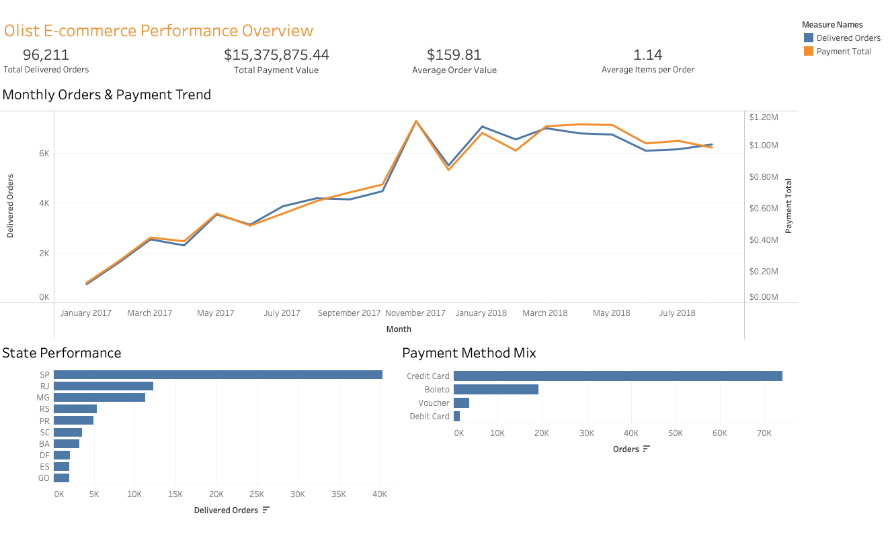
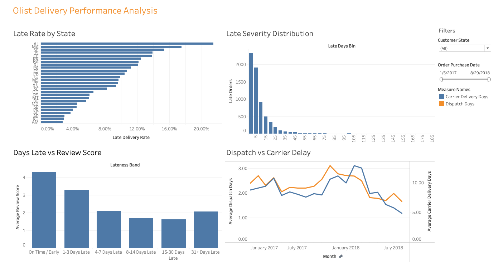
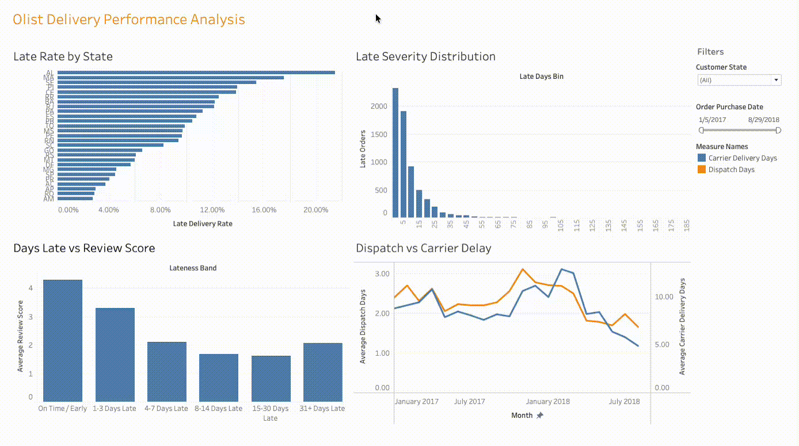
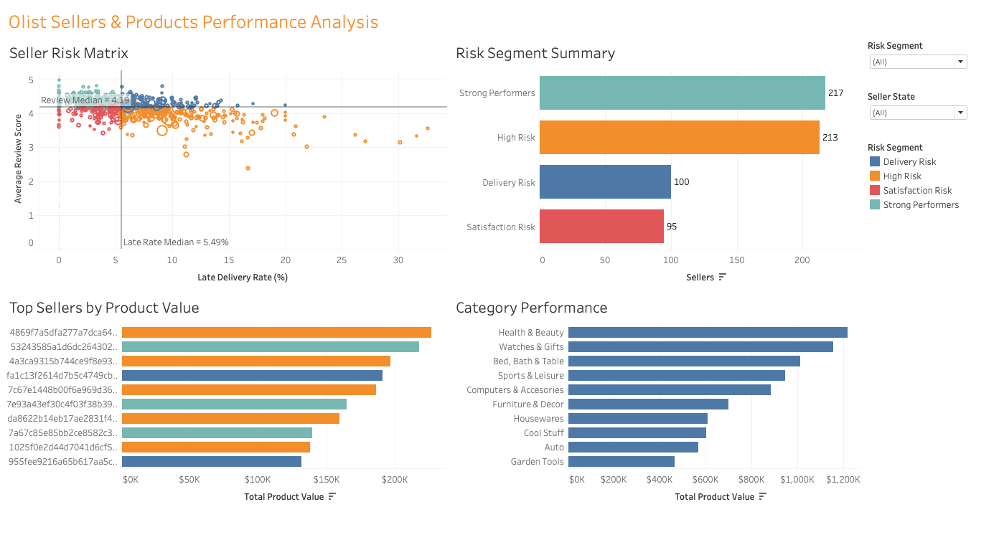
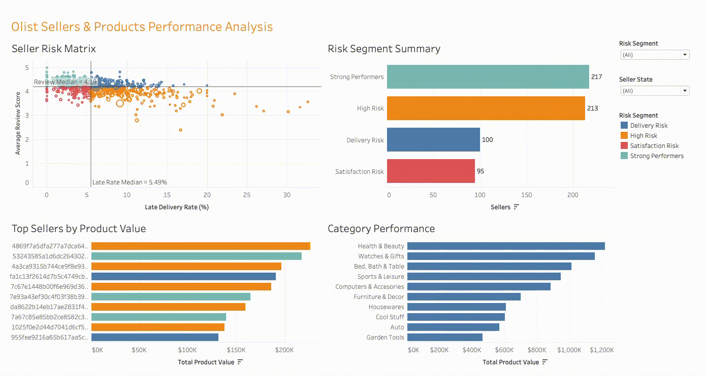
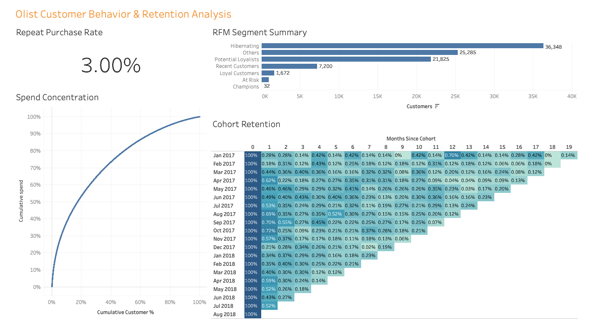

# Olist E-commerce Analytics

## Project Overview

This project is an end-to-end e-commerce analytics case study built using **Python (pandas)**, **MySQL**, and **Tableau**.

The goal was to move beyond basic reporting and build a structured analytics workflow that answers business questions across four areas:

- overall marketplace performance
- delivery and fulfillment performance
- seller and product performance
- customer behavior and retention

The analysis uses the Brazilian Olist e-commerce dataset and follows a full workflow from database setup and validation to reusable SQL views, business analysis, advanced customer analytics, and Tableau dashboards.

---

## Business Questions

The project was designed to answer questions such as:

- How many delivered orders were completed and how much payment value did they generate?
- How did order volume and payment value change over time?
- Which customer states generated the most orders?
- Which payment methods were used most often?
- Which states experienced the highest late-delivery rates?
- How severe were late deliveries?
- How did delivery delays relate to customer review scores?
- How much time was spent in seller dispatch versus carrier delivery?
- Which sellers generated the most product value?
- Which sellers showed delivery or customer-satisfaction risk?
- Which product categories performed best?
- What percentage of customers purchased more than once?
- How concentrated was customer spending?
- Which customer groups were identified through RFM segmentation?
- How well were customers retained after their first purchase?

---

## Tools Used

- **Python / Jupyter Notebook**
  - data inspection and cleaning
  - missing-value handling and format normalization
  - ZIP-prefix geolocation summarization
  - preparing CSV and TSV inputs for MySQL

- **MySQL 8+**
  - schema creation
  - data loading
  - data validation
  - reusable analytical views
  - joins
  - CTEs
  - CASE expressions
  - window functions
  - RFM segmentation
  - cohort retention analysis

- **Tableau Desktop Public Edition**
  - KPI cards
  - trend charts
  - dual-axis charts
  - seller risk matrix
  - interactive filters
  - Pareto analysis
  - cohort retention heatmap
  - dashboard actions
  - calculated fields
  - custom tooltips

---

## Dataset Scope

The reporting period used for the main dashboards is:

**January 2017 through August 2018**

Key source tables include:

- customers
- orders
- order items
- products
- sellers
- payments
- reviews
- product category translation
- geolocation

The analysis focuses primarily on **delivered orders** for completed-sales and fulfillment reporting.

---

## Project Workflow

```text
Raw Olist Data
      ↓
Python Cleaning Notebook / Prepared CSV Files
      ↓
MySQL Database Setup
      ↓
Data Validation
      ↓
Reusable Analytical Views
      ↓
Business & Advanced SQL Analysis
      ↓
Tableau-ready Datasets
      ↓
4 Interactive Tableau Dashboards
```

---

## SQL Project Structure

```text
sql/
├── 01_database_setup.sql
├── 02_data_validation.sql
├── 03_analysis_views.sql
├── 04_business_analysis.sql
├── 05_advanced_sql_analysis.sql
└── 06_tableau_datasets.sql
```

### 01_database_setup.sql

Creates the MySQL database structure, including:

- tables
- primary keys
- foreign keys
- indexes
- cleaned-data imports
- basic load sanity checks

The script uses placeholder local file paths so the project can be cloned and configured on another machine.

### 02_data_validation.sql

Validates the loaded data before analysis.

Checks include:

- actual vs expected row counts
- primary-key uniqueness
- composite-key uniqueness
- foreign-key relationships
- missing values
- invalid numeric ranges
- date-sequence issues
- category translation coverage
- customer and seller geolocation coverage
- index and constraint audits

### 03_analysis_views.sql

Creates reusable analytical views with clearly defined grain.

Important views include:

- `vw_order_item_details`
- `vw_order_financials`
- `vw_order_delivery_performance`
- `vw_order_review_summary`
- `vw_customer_lifetime_summary`
- `vw_seller_lifetime_summary`

These views reduce repeated logic and help prevent incorrect joins across tables with different grains.

### 04_business_analysis.sql

Contains the main business-facing analyses, including:

- overall order and financial KPIs
- delivered-order performance
- monthly order and payment trends
- category performance
- seller performance
- customer-state performance
- delivery performance
- review analysis
- repeat-customer analysis
- payment method mix
- freight burden
- customer spend bands

### 05_advanced_sql_analysis.sql

Demonstrates more advanced analytical SQL, including:

- RFM scoring and segmentation
- customer spend concentration
- category ranking
- seller ranking within state
- running payment totals
- late-delivery outlier ranking
- month-over-month growth using `LAG()`
- cohort retention analysis

### 06_tableau_datasets.sql

Creates the final datasets used in Tableau.

Examples include:

- seller risk matrix
- delivery-review analysis
- category-review analysis
- dispatch vs carrier delay
- overview order-level dataset
- payment method mix
- delivery performance by state
- RFM customers
- cohort retention

---

## Python Data Preparation

[`notebooks/01_data_preparation.ipynb`](notebooks/01_data_preparation.ipynb) documents inspection, cleaning, cross-table checks, and preparation of cleaned CSV/TSV files for MySQL. Paths are relative to the project layout. Run the notebook before database setup if cleaned inputs are not available.

---

## Tableau Dashboards

### 1. Olist E-commerce Performance Overview



Focuses on high-level commercial performance.

Includes:

- Total Delivered Orders
- Total Payment Value
- Average Order Value
- Average Items per Order
- Monthly Orders & Payment Trend
- State Performance
- Payment Method Mix

**Headline metrics**

- **96,211 delivered orders**
- **$15.38M total payment value**
- **$159.81 average order value**
- **1.14 average items per order**

---

### 2. Olist Delivery Performance Analysis



**Filter demonstration:**



Focuses on fulfillment and logistics.

Includes:

- Late Rate by State
- Late Severity Distribution
- Days Late vs Review Score
- Dispatch vs Carrier Delay
- Customer State filter
- Purchase Date filter

This dashboard separates seller/processing time from carrier delivery time and connects delivery performance with customer reviews.

---

### 3. Olist Sellers & Products Performance Analysis



**Filter demonstration:**



Focuses on seller quality, seller risk, and product-category performance.

Includes:

- Seller Risk Matrix
- Risk Segment Summary
- Top Sellers by Product Value
- Category Performance
- Seller State filter
- Risk Segment filter

Seller risk is evaluated using:

- late-delivery rate
- average review score
- delivered-order volume

Seller segments include:

- Strong Performers
- Delivery Risk
- Satisfaction Risk
- High Risk

---

### 4. Olist Customer Behavior & Retention Analysis



Focuses on customer quality, repeat purchasing, spend concentration, and retention.

Includes:

- Repeat Purchase Rate
- RFM Segment Summary
- Spend Concentration
- Cohort Retention

The RFM analysis uses:

- **Recency**
- **Frequency**
- **Monetary Value**

Customer segments include:

- Champions
- Loyal Customers
- Potential Loyalists
- Recent Customers
- At Risk
- Hibernating
- Others

---

## Key Findings

### 1. Repeat purchasing is very low

The repeat purchase rate is approximately **3.0%**.

Most customers in the dataset purchased only once, making retention one of the clearest business challenges in the marketplace.

### 2. Customer frequency is highly concentrated at one purchase

Approximately **97% of customers** placed only one delivered order.

Because frequency is so heavily concentrated, RFM frequency scoring has limited separation compared with a more repeat-heavy business. This is why RFM is treated as supporting analysis rather than the only customer-segmentation method.

### 3. Customer spend is concentrated

The Pareto-style spend analysis shows that a smaller share of customers contributes a disproportionately large share of total spend.

For example, roughly **52% of customers account for about 82% of customer spend**.

This suggests that high-value customer identification can be useful even though repeat purchasing is limited.

### 4. Cohort retention is very low after the first purchase month

Month 0 begins at 100% by definition, but later monthly retention rates are generally below 1%.

This reinforces the finding that the marketplace is driven primarily by one-time buyers rather than frequent returning customers.

### 5. Delivery performance affects customer experience

The delivery analysis connects delivery timeliness with customer review behavior.

Late-delivery severity and review-score analysis help identify where operational issues may be contributing to weaker customer satisfaction.

### 6. Seller performance varies across delivery and satisfaction dimensions

The seller risk matrix separates sellers into four groups using late-delivery rate and average review score.

This makes it possible to distinguish between:

- strong sellers
- sellers with delivery problems
- sellers with customer-satisfaction problems
- sellers with both issues

---

## SQL Concepts Demonstrated

This project includes both foundational and intermediate-to-advanced SQL concepts.

### Core SQL

- `SELECT`
- `WHERE`
- `GROUP BY`
- `HAVING`
- `ORDER BY`
- `CASE`
- aggregate functions
- date functions
- inner joins
- left joins

### Intermediate / Advanced SQL

- Common Table Expressions (CTEs)
- recursive CTEs
- reusable SQL views
- multi-stage aggregation
- joins across different table grains
- `ROW_NUMBER()`
- `DENSE_RANK()`
- `NTILE()`
- `LAG()`
- running totals
- cumulative percentages
- cohort analysis
- RFM segmentation
- conditional aggregation
- `COALESCE()`
- `NULLIF()`

---

## Tableau Skills Demonstrated

- KPI design
- calculated fields
- table calculations
- running totals
- percent-of-total calculations
- dashboard filters
- dashboard actions
- dual-axis charts
- reference lines
- heatmaps
- scatter plots
- custom tooltips
- custom number formatting
- category aliases
- dashboard layout and formatting

---

## Repository Structure

```text
olist-ecommerce-analytics/
├── README.md
├── notebooks/
│   └── 01_data_preparation.ipynb
├── sql/
│   ├── 01_database_setup.sql
│   ├── 02_data_validation.sql
│   ├── 03_analysis_views.sql
│   ├── 04_business_analysis.sql
│   ├── 05_advanced_sql_analysis.sql
│   └── 06_tableau_datasets.sql
├── data/
│   ├── raw/
│   ├── cleaned/
│   └── tableau_exports/
│       ├── seller_risk_matrix.csv
│       ├── delivery_review_analysis.csv
│       ├── category_review_analysis.csv
│       ├── dispatch_carrier_analysis.csv
│       ├── Overview_orders.csv
│       ├── payment_method_mix.csv
│       ├── delivery_state_performance.csv
│       ├── rfm_customers.csv
│       └── cohort_retention.csv
└── tableau/
    ├── Olist_Ecommerce_Analytics.twbx
    └── screenshots/
        ├── performance_overview.png
        ├── delivery_performance.png
        ├── sellers_products.png
        ├── customer_behavior_retention.png
        ├── delivery_filters.gif
        └── seller_risk_interaction.gif
```

> The tree shows the intended local project layout. Before publishing, check large files and keep only the datasets you intend to share. The original raw Olist files may instead be downloaded from the dataset source.

---

## How to Reproduce the Project

1. Obtain the original Olist e-commerce dataset and place the source CSVs in `data/raw/`.
2. Run `notebooks/01_data_preparation.ipynb` to generate the expected files in `data/cleaned/` (or use the supplied cleaned files if included).
3. Configure `LOAD DATA LOCAL INFILE` for your MySQL 8+ installation and replace the **placeholder root path** in `sql/01_database_setup.sql` with your actual local project directory. Merely naming the project folder `olist-ecommerce-analytics` does not make `/YOUR/LOCAL/PATH/` a working path.
4. Run the SQL scripts in numeric order. `02_data_validation.sql` checks the loaded tables; review its results before proceeding.
5. Export the nine final queries from `sql/06_tableau_datasets.sql` to `data/tableau_exports/`, using the CSV names shown above.
6. Open `tableau/Olist_Ecommerce_Analytics.twbx` to explore the packaged Tableau dashboards. The packaged workbook may already contain supporting data, so a MySQL setup is not needed just to view it.

---


## Tableau Public

**Interactive Dashboards:** [View Olist E-commerce Analytics on Tableau Public](https://public.tableau.com/views/OlistE-commerceAnalyticsBusinessPerformanceCustomerRetention/OlistSellersProductsPerformanceAnalysis)


---

## What I Learned

This project helped strengthen my understanding of how SQL and Tableau work together in a realistic analytics workflow.

The most valuable parts of the project were:

- controlling table grain before joining datasets
- separating reusable analytical logic into SQL views
- validating data before analysis
- using window functions for ranking and cumulative analysis
- adapting RFM scoring to the actual customer-frequency distribution
- building cohort retention logic that distinguishes true zero-retention periods from future periods
- translating SQL outputs into business-facing dashboards rather than treating visualization as a separate step

---

## Future Improvements

Possible extensions include:

- seller-level geographic mapping
- freight-cost optimization
- product-level profitability analysis
- customer lifetime value modeling
- predictive late-delivery modeling
- customer churn or repeat-purchase prediction

---

## Author

**Parthasarathi Addala**

MS Business Analytics  
University of Tampa

